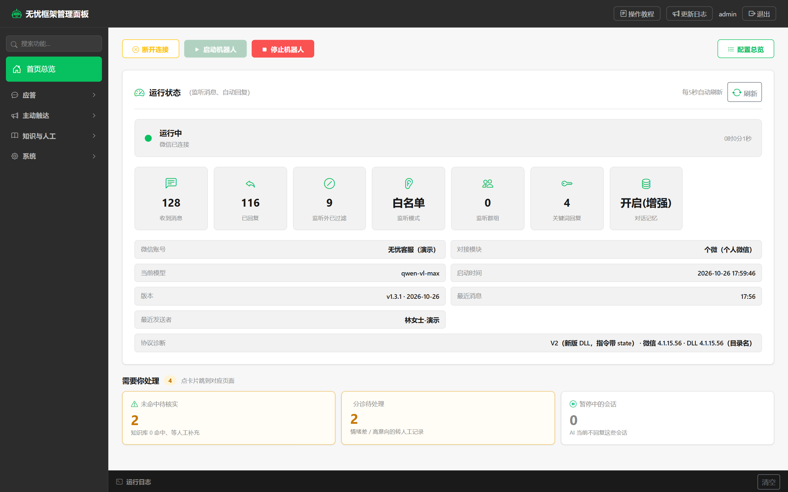

# 无忧面板 · 个微智能客服面板

运行在 Windows 本机的**个微智能客服面板**：监听消息、关键词回复、AI 应答、群聊与朋友圈、语音回复、多账号托管，全部集中在一块本地网页面板里。

本仓库只存放介绍页与更新日志的静态文件，不含面板源码。

## 一句话

客户消息先在本地过一遍：命中关键词按预设话术直接回，没命中交给 AI，AI 拿不准交给人。配置、日志与会话记忆都留在本机，AI 走你在面板里填写的模型接口。

## 功能概览（20 个功能页）

- **应答**：私聊监听名单、关键词回复（每条可带语音、图片、本机文件）、知识库与出处引用（实验）、AI 应答、人工接管
- **好友与群聊**：通过好友后的欢迎链路、群聊只回 @、回复时真 @ 提问者、群成员昵称显示
- **主动触达**：定时消息（文字与语音）、朋友圈刷新与跟发、自定义转发（关键词 / 指定发送人 / 无差别）
- **语音**：AI 回复按比例整条合成语音、复刻音色、语速 0.5–2.0
- **知识与记忆**：云端知识库检索、未命中问题登记、AI 与人工共用会话记忆
- **运行**：一台电脑托管多个账号、启动前自检与诊断、运行日志、影子模式（只判断不发送）

## 运行方式

- Windows 本机运行，单文件 exe，双击即用
- 配置、日志、会话记忆留在本机
- 一台电脑可托管多个账号，在桌面管理器里统一启停

## 演示

介绍页提供演示账号二维码，扫码添加后可体验面板接管的账号（仅功能演示，不处理真实业务）。

- 介绍页：https://yy666261.github.io/wuyou-panel-site/
- 更新日志：https://yy666261.github.io/wuyou-panel-site/changelog.html

常见搜索词：个微智能客服、个人微信客服、微信自动回复、AI 客服、vxhook、SCRM、多账号托管。

## 说明

- 第三方个人微信辅助工具，非腾讯官方产品；个人微信自动化存在账号受限风险，请自行评估并遵守相关协议与法律。
- 页面与截图中的客户名称、群名、文件路径与账号均为演示数据，取自脱敏沙箱环境。
- 带「实验」标记的能力仍在真机灰度，上线前建议先跑影子档。
